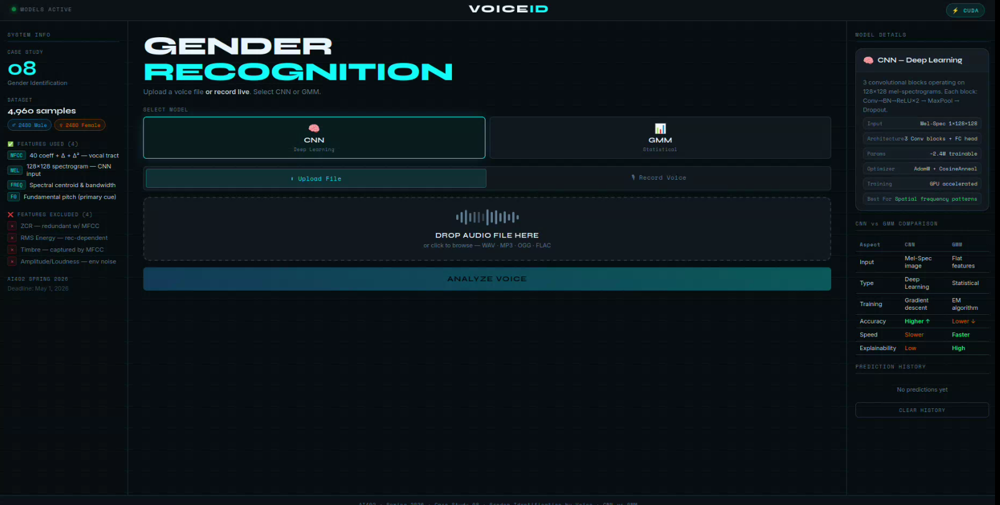

# VoiceID — Voice Gender Classification

A Flask web application and Jupyter notebook for a binary voice-classification case study. VoiceID compares a convolutional neural network (CNN) operating on Mel spectrograms with a Gaussian mixture model (GMM) operating on engineered acoustic features. The web interface accepts audio uploads or short microphone recordings and displays the predicted class, class scores, and basic audio statistics.

> **Scope:** This is an educational machine-learning demonstration trained to distinguish the dataset's *male* and *female* voice labels. It does not determine a person's gender identity, and its predictions may not generalize to speakers, recording conditions, or populations outside the training data.

## Project at a glance

- **Web app:** Flask backend with a browser interface for uploading or recording audio.
- **Models:** CNN classifier and a two-class GMM baseline.
- **Audio features:** 128 × 128 Mel spectrograms for the CNN; MFCCs and deltas, spectral statistics, and estimated fundamental pitch for the GMM.
- **Included artifacts:** Pre-trained model weights, preprocessing configuration, notebook, and experiment plots.
- **Dataset:** 4,960 WAV files (2,480 per class), as described in the notebook.

## Preview



## Repository layout

```text
.
├── app.py                           # Flask app, preprocessing, inference, API routes
├── Gender_Classification_Notebook.ipynb  # Exploration, training, evaluation
├── models/                          # Saved models and preprocessing artifacts
├── plots/                           # Training and evaluation figures
├── templates/index.html             # Web interface
├── static/css/style.css             # Interface styles
└── static/js/main.js                # Upload, recording, and results behavior
```

## Requirements

- Python 3.10 or later is recommended.
- `pip`
- A modern browser; microphone recording requires browser microphone permission and a secure context (localhost is allowed).
- The bundled files in `models/` for real inference. The CNN can use a CUDA-enabled PyTorch installation when available; otherwise it runs on CPU.

The repository does not currently include a dependency lockfile. Install the runtime packages with:

```bash
python -m venv .venv
```

Activate the environment, then install:

```bash
# Windows PowerShell
.venv\Scripts\Activate.ps1

# macOS / Linux
source .venv/bin/activate

python -m pip install Flask librosa joblib numpy torch scikit-learn scikit-image
```

For GPU acceleration, install the PyTorch build appropriate for your CUDA version using the [official PyTorch installation selector](https://pytorch.org/get-started/locally/). CPU inference works without CUDA.

## Run the web app

From the repository root, with the virtual environment active:

```bash
python app.py
```

Open [http://127.0.0.1:5000](http://127.0.0.1:5000) in your browser. The app reports whether model artifacts loaded and which device PyTorch selected. Use the CNN or GMM selector, then upload an audio file or record a clip in the browser. Recording stops automatically after 30 seconds.

Supported uploaded audio extensions are WAV, MP3, OGG, FLAC, M4A, and WEBM. The application limits request size to 32 MiB and resamples audio to 22,050 Hz mono for analysis. The configured analysis window is 5 seconds; shorter clips are zero-padded and longer clips are truncated.

> **Deployment:** `app.py` enables Flask's debug server and binds to `0.0.0.0` for local development. Do not use this development configuration as a production server; deploy behind a production WSGI server and configure the host and debug settings appropriately.

## HTTP endpoints

| Method | Route | Description |
|---|---|---|
| `GET` | `/` | Serves the application and reports model/device status to the page. |
| `POST` | `/predict` | Accepts multipart form fields `audio` (file) and `model` (`cnn` or `gmm`), or an `audio_blob` recording and `model`. Returns JSON with prediction, probabilities, audio statistics, inference time, and demo-mode status. |
| `GET` | `/health` | Returns JSON containing `status`, `models_loaded`, and `device`. |

Example health response:

```json
{"status":"ok","models_loaded":true,"device":"cpu"}
```

## Models and preprocessing

### CNN

The CNN consumes a normalized 128 × 128 Mel spectrogram. Its architecture uses three convolutional blocks with batch normalization, ReLU, max pooling, and dropout, followed by a fully connected classification head. The saved weights are in `models/cnn_best.pth`; class order is stored in `models/label_encoder.pkl`.

### GMM

The GMM path computes a 249-dimensional feature vector: MFCC means and standard deviations, first- and second-order MFCC deltas, spectral centroid/bandwidth/rolloff statistics, and pitch statistics estimated with `librosa.pyin`. Features are scaled with `models/scaler.pkl`. Separate male and female GMMs compare class-conditional log likelihoods.

Both prediction paths use the preprocessing parameters in `models/feat_config.json`. Keep the model files and configuration together with the application; changing preprocessing can make the saved artifacts incompatible.

### Demo mode

If model loading fails (for example, if an artifact is missing or incompatible), the server starts in **DEMO MODE**. In this mode `/predict` returns a randomly selected label and confidence for interface demonstration; it is **not model inference** and must not be used as a result. Check the startup output and `/health` (`models_loaded`) before interpreting predictions.

## Notebook and dataset

`Gender_Classification_Notebook.ipynb` documents the experiment: dataset exploration, feature extraction, stratified train/validation/test splits, GMM component selection, CNN training, and evaluation plots. The notebook expects the dataset in this structure:

```text
data/
├── male/       # WAV files
└── female/     # WAV files
```

The referenced dataset is [Gender Recognition by Voice on Kaggle](https://www.kaggle.com/datasets/murtadhanajim/gender-recognition-by-voiceoriginal/data). The dataset is not included in this repository. Download it separately and arrange the audio under the expected folders before running notebook cells that load data. Notebook dependencies include the runtime packages above plus `pandas`, `matplotlib`, `seaborn`, `soundfile`, and `tqdm`.

The checked-in notebook reports 99.60% test accuracy for both CNN and GMM on its 744-sample test split. These are the notebook's reported results on that dataset and split, not a guarantee of performance on new or independently collected recordings.

## Included figures

The `plots/` directory contains the notebook's generated figures, including class distribution, feature analyses, model training curves, ROC curves, confusion matrices, and CNN/GMM comparisons.

## License

No license file is currently included. Unless the repository owner adds a license, standard copyright restrictions apply to reuse and redistribution of this code and its artifacts. Review the dataset's own terms separately before using or redistributing it.
